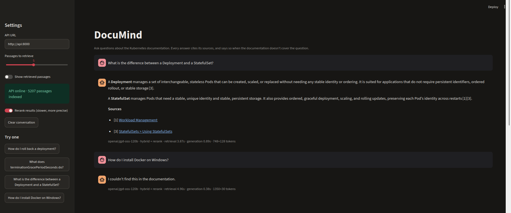
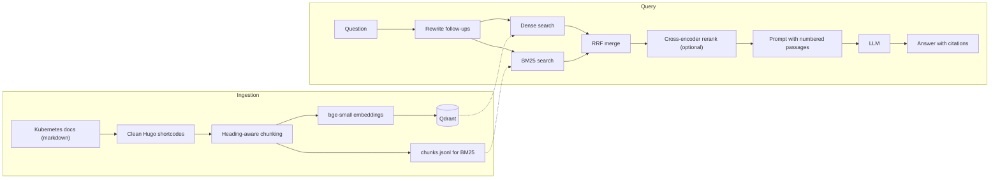

# DocuMind


Retrieval-augmented question answering over the Kubernetes documentation. Ask a question, get a short answer
that **cites the documentation pages it used**, or an explicit "I couldn't find this in the documentation"
when the docs don't cover it. Built end to end: ingestion, hybrid retrieval, reranking, grounded generation,
an API, a chat UI, Docker packaging, and a measured evaluation.



**Why it exists.** Searching hundreds of documentation pages is slow, and a plain chatbot answers from memory and
can invent flags or fields. DocuMind retrieves the relevant passages first and lets the model answer *only* from
them, so every claim can be checked against its source. The same pipeline works for any document collection
(internal wikis, product manuals, API docs); Kubernetes is the demo corpus.

| | |
|---|---|
| Retrieval | `BAAI/bge-small-en-v1.5` embeddings in Qdrant, BM25, Reciprocal Rank Fusion, `ms-marco-MiniLM` cross-encoder |
| Generation | Groq (`gpt-oss-120b`), any OpenAI-compatible API works; numbered citations; refusal when the docs don't cover it |
| Serving | FastAPI, Streamlit, Docker Compose, GitHub Actions (ruff + pytest) |
| Evaluation | 55 retrieval questions, 20-question LLM-judged answer test, results regenerated from files |

## Example

> **Q:** How do I install Docker on Windows?
> **A:** I couldn't find this in the documentation.

> **Q:** What is the difference between a Deployment and a StatefulSet?
> **A:** A Deployment manages interchangeable, stateless Pods... A StatefulSet manages Pods that need a stable, unique identity and persistent storage... *(with numbered citations and linked sources)*

## What it does

- **Ingestion**: cleans Hugo shortcodes out of ~400 Kubernetes docs pages, splits them by heading into ~5,200
  chunks (each prefixed with a `Page > Section` breadcrumb), embeds them with `bge-small-en-v1.5` and stores
  them in Qdrant.
- **Hybrid retrieval**: dense vector search and BM25 keyword search (with an identifier-aware tokenizer for
  names like `terminationGracePeriodSeconds`), merged with Reciprocal Rank Fusion.
- **Reranking** (switchable): a small cross-encoder re-scores the top fused candidates.
- **Grounded generation**: the LLM (Groq, any OpenAI-compatible API works) sees numbered passages, must cite
  them, and must refuse when the passages don't contain the answer. Source links are attached by code from the
  citations the answer actually used.
- **Follow-up questions**: a short LLM call rewrites "and how do I undo it?" into a standalone question first.
- **Service + UI**: FastAPI (`/ask`, `/health`, interactive docs at `/docs`) and a Streamlit chat page that can
  show the retrieved passages and their retriever ranks.
- **Evaluation**: a 55-question retrieval test set, retrieval metrics (Hit@k, MRR) at chunk and page level, and an
  LLM-judged check of answer correctness, faithfulness and refusals.

## Architecture



## Results

Numbers below are generated from the files in `eval/results/` by `python -m src.evaluation.make_report`.

<!-- RESULTS:START -->
**Retrieval** (47 single-page questions, 8 comparison questions needing two pages). Chunk-level = the exact source chunk (strict); page-level = any chunk of the right page (lenient).

| Method | Chunk Hit@1 | Chunk Hit@5 | Chunk MRR | Page Hit@1 | Page Hit@5 | Page MRR | Both pages in top 5 |
|---|---|---|---|---|---|---|---|
| dense | 0.55 | 0.87 | 0.691 | 0.81 | 0.98 | 0.888 | 0.75 |
| bm25 | 0.60 | 0.89 | 0.735 | 0.79 | 0.96 | 0.872 | 0.25 |
| hybrid (RRF) | 0.60 | 0.89 | 0.735 | 0.79 | 1.00 | 0.885 | 0.38 |
| hybrid + rerank | 0.72 | 0.92 | 0.802 | 0.87 | 1.00 | 0.933 | 0.88 |

**Answer quality** (LLM judge; counts shown because the sample is small).

| Pipeline | Correct | Correct or partial | Faithful | False refusals | Out-of-scope refused | Mean latency | Tokens/answer |
|---|---|---|---|---|---|---|---|
| hybrid (RRF) | 16/16 (100%) | 16/16 (100%) | 16/16 (100%) | 0/16 (0%) | 4/4 (100%) | 5.6s | 1606 |
| hybrid + rerank | 15/16 (94%) | 16/16 (100%) | 15/16 (94%) | 0/16 (0%) | 4/4 (100%) | 7.2s | 1592 |
| hybrid + rerank, prompt v2 | 15/16 (94%) | 16/16 (100%) | 15/16 (94%) | 0/16 (0%) | 4/4 (100%) | 7.8s | 1685 |
<!-- RESULTS:END -->

**How to read these numbers**

- The test set was drafted by an LLM from real chunks (questions were told to paraphrase, not copy), then
  reviewed by hand; the comparison and out-of-scope questions are hand-written. Two questions found to be
  mislabeled after reading failures were removed from both runs.
- Retrieval uses 55 questions and answer quality only 16 answerable ones (plus 4 out-of-scope), so one question moves a percentage by several points.
  Small differences are noise.
- The answer judge is an LLM (a smaller model than the one answering). Treat the scores as a consistent
  yardstick for comparing versions, not as ground truth.

**What the evaluation taught me**

- Hybrid (dense + BM25) search was **not clearly better than dense alone** on single-page questions, and plain RRF
  was worse than dense on questions that need two pages, because the weaker BM25 list pulled in wrong pages.
- The **cross-encoder reranker gave the clearest retrieval gain** (better top-1 ranking and better coverage of
  two-page questions) for a few extra seconds of CPU time per question. That gain did not visibly change answer
  quality at this sample size, because the generator reads five passages either way.
- The main answer-quality weakness is **unfaithfulness**: occasionally the model adds true-sounding details that
  are not in the retrieved passages. The prompt forbids it, but a prompt alone does not fully stop it. I tested a
  stricter prompt (`PROMPT_VERSION=v2`: check each fact against the cited passage, drop unsupported details) on the
  same 20 questions: results were identical (15/16 correct, 15/16 faithful, the same single miss) and answers used
  ~6% more tokens, so v1 stays the default. The remaining miss is a question where the passages only partly cover
  the topic and the model elaborates; fixing that likely needs an answer-vs-passage verification step, not wording.

## Quickstart (Docker)

Requires Docker with Compose, and a free [Groq](https://console.groq.com) API key.

```bash
git clone https://github.com/Anjana-Naidu-25/documind.git && cd documind
cp .env.example .env                 # then put your GROQ_API_KEY in .env

bash scripts/fetch_docs.sh           # downloads the Kubernetes docs into data/raw/k8s
docker compose up -d qdrant
docker compose run --rm ingest       # builds the index; about an hour on 4 CPUs the first time,
                                     # incremental afterwards (unchanged chunks are not re-embedded)
docker compose up -d --build         # API on :8000, UI on :8501
```

Open http://localhost:8501. Set `USE_RERANK=0` in `.env` to turn the reranker off.

## Local development

```bash
python3 -m venv .venv && source .venv/bin/activate
pip install torch --index-url https://download.pytorch.org/whl/cpu
pip install -r requirements.txt
python -m pytest -q                                   # unit tests, no Qdrant or API key needed

docker compose up -d qdrant
python -m src.ingestion.run                           # add --rebuild to start from scratch
uvicorn src.api.main:app --port 8000
streamlit run ui/app.py
python -m src.generation.rag "how do I roll back a deployment?" --debug
```

Evaluation:

```bash
python -m src.evaluation.make_testset                 # draft questions with the LLM, then review the file by hand
python -m src.evaluation.retrieval_eval --rerank --tag final     # free: no LLM calls
python -m src.evaluation.generation_eval --n 20 --tag baseline-now   # uses API tokens; resumable
python -m src.evaluation.generation_eval --n 20 --tag rerank-now --rerank
PROMPT_VERSION=v2 python -m src.evaluation.generation_eval --n 20 --tag rerank-v2 --rerank
python -m src.evaluation.make_report                  # refresh the tables above
```

## Project layout

```
src/ingestion/   loader, cleaner (Hugo shortcodes), chunker, incremental embedding + Qdrant upsert
src/retrieval/   dense, bm25, hybrid (RRF), rerank (cross-encoder)
src/generation/  prompt, llm client (retry/backoff), rag pipeline, follow-up rewriting
src/api/         FastAPI service
src/evaluation/  test set, metrics, retrieval and answer evaluation, report generator
ui/app.py        Streamlit chat page
eval/            test set and raw result files
tests/           unit tests (run in CI)
```

## Limitations

- Covers only the `concepts` and `tasks` sections of the docs. Questions about other sections are refused.
- No streaming responses; on CPU, reranking adds a few seconds per question.
- Free-tier LLM rate limits apply, so evaluation runs are small and resumable.
- Evaluation questions are synthetic. A real user query log would be a better test set.

## Data and attribution

The documentation text comes from [kubernetes/website](https://github.com/kubernetes/website) and is licensed
CC BY 4.0 by The Kubernetes Authors; answers link back to kubernetes.io. This project is not affiliated with or
endorsed by the Kubernetes project or the CNCF.
